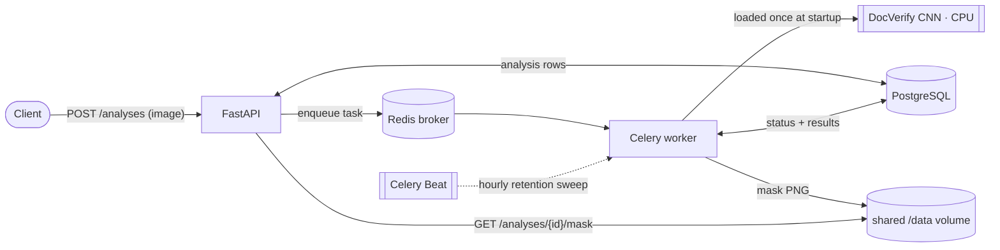
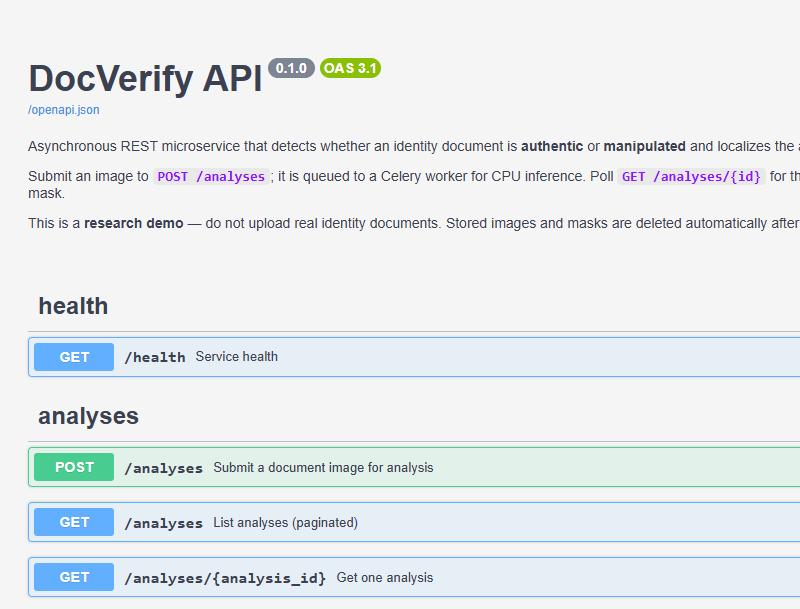

# DocVerify API

[](https://github.com/HernanDiaz/IDVerify/actions/workflows/ci.yml)


Asynchronous REST microservice that wraps **DocVerify** — a multi-task CNN that
decides whether an identity document is **authentic** or **manipulated** and
localizes the altered regions with a pixel mask (from the Pattern Recognition
Letters 2026 paper, [doi:10.1016/j.patrec.2026.08.021](https://doi.org/10.1016/j.patrec.2026.08.021)).

The focus of this branch is **backend engineering**, not the model: a clean
async API, a background inference worker, a relational store with migrations,
tests, containers and CI.

> ⚠️ **Research demo — do not upload real identity documents.** Inference runs on
> synthetic documents from the public FantasyID dataset. Uploaded images and
> generated masks are stored on disk only and **deleted automatically after 24 h**
> by a scheduled job.

**Stack:** FastAPI · PostgreSQL (SQLAlchemy 2 async + Alembic) · Redis · Celery ·
pytest · Docker Compose · GitHub Actions.

---

## Architecture



1. `POST /analyses` validates the upload, stores the image on disk, inserts a
   `pending` row and enqueues a Celery task — returning immediately.
2. The worker (model loaded **once per process**) runs CPU inference, writes the
   verdict, probabilities, timing and mask path back to PostgreSQL, and saves the
   mask PNG to the shared volume.
3. Clients poll `GET /analyses/{id}` until `done`/`failed`.
4. Celery Beat deletes images and masks older than the retention window.

---

## Quickstart (about a minute)

Requires Docker and Docker Compose.

```bash
cp .env.example .env

# Option A — real model: provide the trained weights (never committed to git)
make weights WEIGHTS_SRC=/path/to/model_multitask_seed47.pt

# Option B — no weights at hand: set USE_MOCK_MODEL=true in .env to use a fake predictor

make up           # docker compose up --build  (api, worker, redis, postgres)
```

Then open the interactive docs at **http://localhost:8000/docs** and the health
check at **http://localhost:8000/health**.



---

## API

| Method | Path | Description |
| ------ | ---- | ----------- |
| `POST` | `/analyses` | Submit a JPEG/PNG document; returns `{id, status: "pending"}`. |
| `GET`  | `/analyses/{id}` | Status and, when done, verdict + probabilities + mask URL. |
| `GET`  | `/analyses` | Paginated listing (`?limit=&offset=`). |
| `GET`  | `/analyses/{id}/mask` | The predicted mask as `image/png`. |
| `GET`  | `/health` | Liveness/readiness for the API, database, Redis and model. |

### Examples

```bash
# Submit a document
curl -s -X POST http://localhost:8000/analyses \
     -F "file=@document.jpg;type=image/jpeg"
# {"id":"7c1e...","status":"pending"}

# Poll for the result
curl -s http://localhost:8000/analyses/7c1e...
# {
#   "status": "done",
#   "verdict": "manipulated",
#   "probabilities": {"manipulated": 0.82, "authentic": 0.18},
#   "pred_coverage": 4.1,
#   "inference_ms": 83.0,
#   "mask_url": "/analyses/7c1e.../mask"
# }

# Download the mask, or embed it as base64
curl -s http://localhost:8000/analyses/7c1e.../mask -o mask.png
curl -s "http://localhost:8000/analyses/7c1e...?include_mask=true"

# List and health
curl -s "http://localhost:8000/analyses?limit=10&offset=0"
curl -s http://localhost:8000/health
```

**Validation:** non-JPEG/PNG uploads and corrupt images return **422**; files over
the size limit return **413** (both with a clear message).

---

## Performance

Measured on an 8-core CPU with the real model, 60 inferences after warm-up
(`scripts/bench.py` runs the end-to-end HTTP benchmark against a live stack).

| `TORCH_NUM_THREADS` | mean | p50 | p95 |
| ------------------- | ---- | --- | --- |
| 1 | 154 ms | 154 ms | 165 ms |
| 2 | 103 ms | 102 ms | 115 ms |
| 4 | 82 ms  | 82 ms  | 90 ms  |

**What was optimized**

- **Load the model once per worker process** (via Celery's `worker_process_init`),
  not per task — a cold `torch.load` + build would otherwise be paid on every
  request. Readiness is published to Redis and surfaced by `/health`.
- **`torch.inference_mode()`** around the forward pass removes autograd bookkeeping.
- **`TORCH_NUM_THREADS`** is configurable. The model is small, so intra-op
  threading gives sub-linear gains (above): for lowest **latency** use more
  threads per worker; for highest **throughput** on a multi-core host, run more
  worker processes with 1 thread each and scale horizontally.
- **Batch size is 1** by design — requests arrive independently and latency
  matters more than batch throughput for an interactive API.
- The API stays responsive under load because inference happens **off the request
  path** in the worker; the event loop only does I/O.

---

## Testing

```bash
make test       # fast suite: SQLite + mock model + Celery eager — no services needed
make test-all   # also the slow, real-model inference test (needs weights + torch)
make lint       # ruff + mypy
```

The fast suite exercises every endpoint (httpx `AsyncClient`), upload validation,
the Celery task in eager mode, preprocessing and the retention job. The real
model is covered by a `@pytest.mark.slow` test that is auto-skipped when the
weights are absent. **CI** runs ruff, mypy and pytest (against real Postgres and
Redis service containers) plus an Alembic upgrade/downgrade round-trip on every
push and pull request.

---

## Design decisions

- **Async end to end on the API**: FastAPI + SQLAlchemy 2 async (asyncpg). The
  Celery worker is synchronous, so it uses a **separate sync engine** (psycopg)
  over the same ORM models — avoiding the event-loop/connection pitfalls of
  driving an async engine from a worker, which Alembic shares too.
- **Images on disk, never in the database.** The DB holds only metadata, outputs
  and a filesystem path; the retention sweep deletes the files.
- **UUID primary keys** so analysis ids are not guessable or enumerable.
- **Validation in depth**: declared content type *and* magic bytes are checked,
  and the body is read with an upper bound so an oversized upload is rejected
  without buffering it whole.
- **PyTorch is an optional extra.** The API, the mock predictor and the whole
  fast test suite never import torch, keeping CI and local installs light; the
  Docker image installs the CPU wheel explicitly.
- **Small, reviewable commits**, typed code (`mypy --strict`) and a standard
  layout.

---

## Project layout

```
app/
  api/        # routes, dependencies (validation, pagination)
  core/       # settings, logging
  db/         # declarative base, async + sync sessions
  models/     # SQLAlchemy ORM (Analysis)
  schemas/    # Pydantic request/response contracts
  services/   # model architecture, inference, storage, data access
  workers/    # Celery app, tasks, Beat schedule
tests/        # fast suite + slow real-model test
alembic/      # migrations
scripts/      # bench.py, locustfile.py
```

## License

MIT (service code). The DocVerify model and the FantasyID dataset keep their own
licenses.
